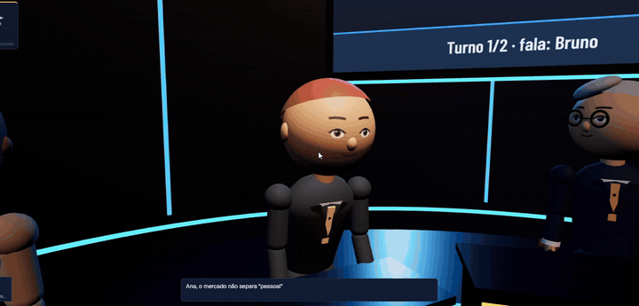

# Mesa de IAs



Uma sala de reuniões 3D no navegador onde LLMs debatem um tema ao redor de uma mesa redonda. Cada cadeira é um modelo diferente, com **temperamento** (explosivo, cético, conciliador...) e **expertise** (cientista, economista, filósofo...) próprios, e um **moderador ativo**, também uma LLM, decide quem fala, provoca os calados e encerra o debate com resumo e veredito. Roda com provedores de IA gratuitos e tem um modo demo (replay) que não precisa de chave.

Stack: Next.js (App Router), React Three Fiber + drei, SDK `openai` (endpoints OpenAI-compatíveis), TypeScript, Vitest.

## Como funciona

O servidor não mantém conexão longa: o navegador conduz o debate, pedindo **um passo por requisição** (cabe no limite de duração das funções gratuitas da Vercel).

```
┌──────────── Navegador ────────────┐
│ Config ─► estado do debate        │
│ Cena 3D (R3F) ◄─ eventos ◄─┐      │
│ Balão, transcrição, voz    │      │
└────────────────────────────┼──────┘
                             │  POST /api/debate/step  (um passo por vez)
┌────────────────────────────▼──────┐
│ Servidor Next.js                  │
│  motor: moderador + membros       │
│  catálogo: GET /api/models        │
└────────────────────────────┬──────┘
                             │  API OpenAI-compatível
        Groq · NVIDIA NIM · OpenRouter · Google AI Studio · Mistral · Cerebras
```

As chaves vão do navegador ao servidor só na requisição (nada é salvo nem logado). Um debate gravado é só uma lista de eventos em JSON, e o replay usa o mesmo player.

## Recursos da v1

- Debate rápido: o visitante digita só o tema; o servidor pesquisa notícias, mostra o repertório para revisão e monta a mesa (4 debatedores, 2 turnos) com a chave NVIDIA do deploy
- Mesa redonda com 2 a 8 membros mais moderador
- Moderador ativo: passa a palavra, provoca, atualiza o resumo e encerra
- Vontade de falar: mão levantada em cena, quem é citado ou discorda tende a responder
- Temperamento e expertise prontos, aleatórios ou personalizados
- Catálogo de modelos por provedor, com filtro "só gratuitos"
- Cena 3D com três câmeras (livre, órbita, diretor), avatares "Terno" com emoções e gestos
- Balão de fala, transcrição lateral e voz opcional do navegador
- Demo em replay sem chave e download do debate em JSON ("Baixar debate")

## Rodando localmente

```bash
npm install
```

Crie `.env.local` (veja `.env.example`) com as chaves dos provedores que for usar, só os nomes abaixo, você preenche os valores:

```
GROQ_API_KEY=
NVIDIA_API_KEY=
OPENROUTER_API_KEY=
GOOGLE_API_KEY=
MISTRAL_API_KEY=
CEREBRAS_API_KEY=
```

Também dá para colar as chaves na tela de configuração (ficam só em `sessionStorage`).

```bash
npm run dev      # http://localhost:3000
npm test         # testes (Vitest)
npx tsx scripts/smoke-providers.ts   # testa cada chave: lista modelos e faz uma chamada curta
```

## Deploy público

Chaves no ambiente do servidor valem para qualquer visitante, que gastaria a sua cota. Por isso, em produção (`NODE_ENV=production`) o servidor ignora essas variáveis em "Montar minha mesa", e cada pessoa cola as próprias chaves na tela. Só defina `MESA_ALLOW_ENV_KEYS=1` se o deploy for privado (por exemplo, atrás de login).

A exceção é o **debate rápido**, pensado para quem só quer experimentar:

- Com `NVIDIA_API_KEY` definida, a home mostra um campo de tema. Sem ela, o campo não aparece e o resto do app funciona igual.
- Antes do debate o servidor pesquisa notícias sobre o tema (cerca de 25 s) e o visitante revisa o repertório.
- A chave só é usada nesse modo. Do visitante valem o tema, o repertório revisado (até 8 KB) e o estado do debate (com teto de tamanho); a mesa, os modelos e os prompts são montados no servidor a cada passo.
- O modelo é o melhor Nemotron do catálogo NVIDIA, ou o que estiver em `MESA_QUICK_MODEL`. As chamadas vão sem raciocínio, para cada passo caber no limite de 60 s da rota.
- Há um limite de 60 passos por hora por IP e 600 no total. O contador fica na memória de cada instância: segura uso casual, não um ataque. Para um limite de verdade, troque por um contador compartilhado (Upstash, Vercel KV).

Na Vercel: importe o repositório, adicione `NVIDIA_API_KEY` em *Settings → Environment Variables* e faça o deploy. Nenhuma outra configuração é necessária.

## Provedores gratuitos

| Provedor | Variável | Onde pegar a chave |
|---|---|---|
| Groq | `GROQ_API_KEY` | https://console.groq.com/keys |
| NVIDIA NIM | `NVIDIA_API_KEY` | https://build.nvidia.com/settings/api-keys |
| OpenRouter (modelos `:free`) | `OPENROUTER_API_KEY` | https://openrouter.ai/keys |
| Google AI Studio (Flash/Gemma) | `GOOGLE_API_KEY` | https://aistudio.google.com/apikey |
| Mistral (tier de experimentação) | `MISTRAL_API_KEY` | https://console.mistral.ai/api-keys |
| Cerebras | `CEREBRAS_API_KEY` | https://cloud.cerebras.ai/platform |

Os limites gratuitos mudam; o app respeita um intervalo mínimo entre chamadas por provedor.

## Gravando um replay de demonstração

1. Monte uma mesa, rode um debate até o fim.
2. No painel final, clique em **Baixar debate** (gera um `.json`).
3. Salve o arquivo em `src/replays/` (substituindo `demo-1.json`, que é o replay do botão "Assistir demo").

## Roadmap

- **v2, drama:** interrupções, modo Pontuado (moderador-juiz com placar em cena), gestos mais ricos por temperamento
- **v3, escala:** 20 a 30 membros, formatos painel + plateia e bancadas, otimizações de render
- **v4, produção:** membros produzem um artefato (código, texto) num quadro central e debatem sobre ele
- **Futuro:** skins extras (robôs, sprites, humanoide), voz neural

## Inspirações

LLM Council, ChatDev e AI Town. A ideia nasceu de um projeto anterior feito com CrewAI; esta versão foi escrita do zero.
